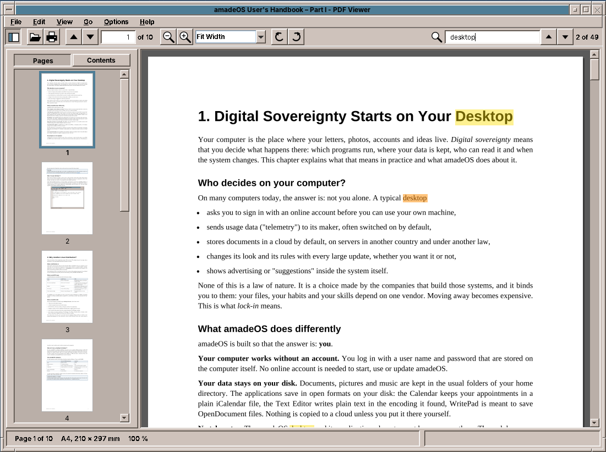
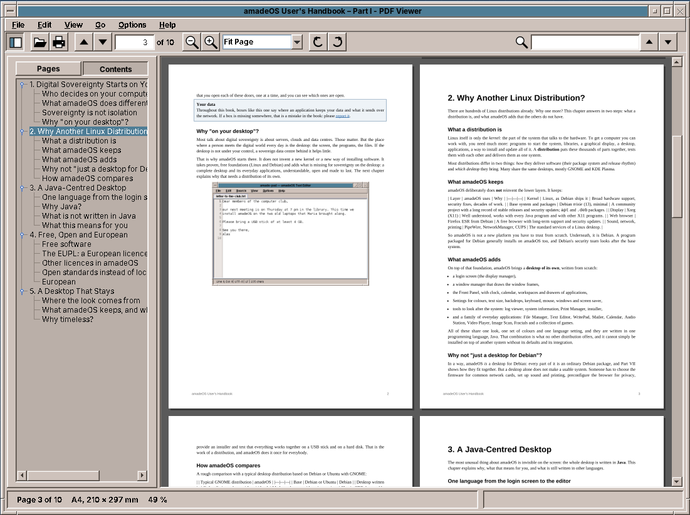

# amade-pdfviewer

**amade-pdfviewer** is the PDF viewer of the [amadeOS](https://github.com/amadeos-eu/amadeos) desktop: pages, thumbnails, the table of contents, search, text selection, printing and a presentation mode in one Motif window. Built like the other amadeOS applications, with [Apache PDFBox](https://pdfbox.apache.org/) for reading and drawing the pages.




## Features

- **Opening**: *File → Open* (Ctrl+O), the last ten files in *File → Recent*, a file dropped on the window, or `amade-pdfviewer file.pdf` (also `file://` URLs). Password-protected files ask for the password.
- **Three views** in *View* (Ctrl+1, Ctrl+2, Ctrl+3): **Continuous** (all pages below each other), **Single Page** and **Two Pages** (side by side like a book, the first page alone on the right). The view is remembered.
- **Zoom** from 10 % to 800 %: *Fit Page*, *Fit Width*, the steps in the toolbar box or any typed value (`150`, `150 %`), Ctrl++ and Ctrl+−, Ctrl+0 for 100 %, and Ctrl+wheel around the mouse pointer. 100 % is the paper size on a 96 dpi screen.
- **Rotation** by 90° (Ctrl+Left, Ctrl+Right), for the shown document; the file stays unchanged.
- **Sidebar** (F9) with **Pages**, the thumbnails, and **Contents**, the outline of the document. A click goes to the page or the heading.

  
- **Moving around**: Page Up, Page Down, Space and the arrow keys scroll; Ctrl+Page Up and Ctrl+Page Down turn pages; Ctrl+Home and Ctrl+End go to the first and last page; the page box in the toolbar or *Go → Go to Page* (Ctrl+G). Links inside the document jump to their target, links to the web open in the browser. **Back** and **Forward** (Alt+Left, Alt+Right) return from a jump.
- **Search** (Ctrl+F): the search box in the toolbar finds text on all pages, ignoring case and line breaks, and marks every match; F3 and Shift+F3 go to the next and previous one, the toolbar shows "2 of 17".
- **Text selection** with the mouse, a double click selects a word; Ctrl+C copies, Ctrl+A selects the page.
- **Printing** (Ctrl+P) through the system print dialog.
- **Presentation** (F5): full screen, one page at a time; a click, Space, the arrow keys and Page Down go on, Esc ends.
- **Properties** (Alt+Enter): title, author, subject, keywords, creator, producer, dates, PDF version, page count, page size in mm and its name (A4, Letter, …), file size and encryption.
- **Reading position**: each file reopens at its last page, zoom and rotation (the last 300 files, in `~/.config/amadeos/pdfviewer/positions.properties`).
- **Reload**: when the file changes on disk, for example because LaTeX wrote it again, the viewer reloads it and keeps the position. Ctrl+R reloads by hand.
- Five languages (English, Deutsch, Français, Español, Italiano), following the amadeOS desktop language; *Options → Language* overrides it.
- Theme colours and Motif look from [amade-commons](https://github.com/amadeos-eu/amade-commons).

## Architecture

Java 25, Swing and Guice; start-up, theme and language come from `AmadeApplication` in amade-commons.

| Package | Contents |
|---|---|
| `bootstrap` | `AmadePdfViewerApplication`, `PdfViewerModule` |
| `domain` | `PdfDocument` (the only class that uses PDFBox: pages, text, links, outline, printing), `DocumentThread` (one thread with priorities for all PDFBox work), `DocumentSession` (rendered pages, tiles, thumbnails and texts with a memory limit), `PageLayout` (where each page lies in the view), `PageText` (characters with their boxes: search, selection, words), `Zoom`, `Rotation`, `ViewMode`, `Target`, `OutlineEntry`, `PageLink`, `DocumentProperties`, `PaperNames` |
| `repository` | `PdfViewerPreferences` (`~/.config/amadeos/pdfviewer/pdfviewer.properties`), `ReadingPositions` |
| `ui.main` | window, presenter, menus, `PageView`, `Sidebar`, `PresentationWindow` |

PDFBox is not thread-safe, so every access to the document runs on the `DocumentThread`, one job at a time. The visible pages come first, then their text, then the pages ahead, then thumbnails, then the search; scrolling cancels the jobs that are no longer needed. A page larger than 12 million pixels is drawn in tiles of 1024 × 1024, so 800 % stays possible; while a page is being drawn, the view scales an earlier picture of it.

## Build and run

```sh
./gradlew run                              # start
./gradlew test                             # Swing tests need a display: xvfb-run ./gradlew test
./gradlew deb                              # build/distributions/amade-pdfviewer_<version>_all.deb
./gradlew installToAmadeOs                 # the .deb into ../amadeos/config/packages.chroot/ for the ISO build
```

If `../amade-commons` is checked out next to this repository, Gradle builds against that checkout instead of the JitPack version.

## Planned

- A night mode (light text on dark pages)
- Filling in PDF forms and saving them
- Annotations: highlighting and notes
- Comic archives (CBZ)
- EPUB books get their own program, **amade-books**, because they flow like web pages instead of having fixed pages

## License

[EUPL-1.2](LICENSE)
